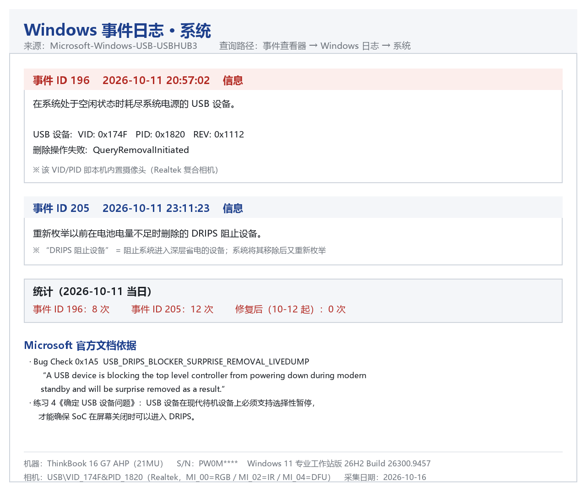

# CamFix — Windows 内置摄像头「间歇性失效 / 画面降级」诊断工具

一个针对 **ThinkBook 16 G7 AHP (21MU)** 内置摄像头间歇性失效问题的根因分析与诊断工具。
**C++17 + Win32 API,单文件 exe,零依赖。**

## 下载

不用自己编译：到 **[Releases](https://github.com/zhe-du/camfix/releases/latest)** 下载 `CamFix.exe`（单文件，免安装，双击即用）。

> exe 未签名，首次运行可能被 SmartScreen 拦下 —— 点「更多信息 → 仍要运行」。
> 想自己编译见下方「构建」。

> **结论先行**:这是 Windows 现代待机(Modern Standby)的电源管理行为,与 Realtek DMFT
> 复合相机「选择性暂停」能力不匹配所致 —— **不是摄像头硬件损坏**。

---

## 现象

同一台机器上出现两种看似无关的症状:

| 症状 | 表现 |
|---|---|
| A | 相机从设备管理器消失,相机应用报 `0xA00F4244 NoCamerasAreAttached` |
| B | 相机**仍在位**、状态显示「已启动」,但只能输出 **160×120 @9fps**,画面糊到不可用 |
| C | 两者都会在一段时间后**自行恢复**(无需重启) |

**关键点**:症状 B 里设备状态是正常的 —— 所以"重装驱动/换硬件"这些思路都解释不了它。

---

## 根因

本机为 **S0 低电量待机(Modern Standby)**。Windows 的规则是:

> 只有挂在同一 USB 控制器上的**所有设备都进入低功耗**,控制器才允许断电进入 **DRIPS**。

该相机是**复合设备**(`MI_00` RGB / `MI_02` IR / `MI_04` DFU),带联想 DMFT 机制
(`USB\MS_COMP_LNVDMFT` + `WdmCompanionFilter` + `lnvdmft.inf`)。只要有一个接口无法
正确进入/退出 D3,整条控制器就被拖住 → 相机被判为 **DRIPS 阻止设备** → 系统**强制移除**它。

系统日志直接记录了这一幕(来源 `Microsoft-Windows-USB-USBHUB3`):

```
事件 ID 196
  在系统处于空闲状态时耗尽系统电源的 USB 设备。
  USB 设备: VID: 0x174F PID: 0x1820 REV: 0x1112
  删除操作失败: QueryRemovalInitiated

事件 ID 205
  重新枚举以前在电池电量不足时删除的 DRIPS 阻止设备。
```

微软对此有专门定义:bug check **`0x1A5 USB_DRIPS_BLOCKER_SURPRISE_REMOVAL_LIVEDUMP`** ——
*"阻止顶层控制器在现代待机期间断电的 USB 设备,将被强制移除(surprise removed)。"*


**于是三种症状对应同一原因:**
- 移除成功 → 相机消失(症状 A)
- 移除失败但枚举状态受损 → 重枚举只协商出 160×120(症状 B)
- 重新枚举成功 → 自行恢复(症状 C)

---

## 这个工具做什么

**v1.2.0 起：双击就是「一键修到好」** —— 诊断后若相机不在场，自动跑完整修复阶梯，
中途任何一步把相机救回来就立刻停手。

```
CamFix.exe              一键：诊断 → 不在场则自动深度修复(正常时免 UAC、不打扰)
CamFix.exe --diag       只诊断,免管理员
CamFix.exe --status     单行状态输出(供脚本调用)
CamFix.exe --recover    只重启相机设备(恢复画质)
CamFix.exe --deep       强制深度修复(即使相机在位也跑一遍阶梯)
CamFix.exe --repair     完整修复: 注册表备份 + 设备级参数 + 全局 hub 开关 + 电源计划 + 重启
CamFix.exe --restore    回滚到最近一次 backup\*.reg
CamFix.exe --auto       静默自检(供开机自启),异常才弹窗
```

**深度修复阶梯（v1.2.0 新增，`--deep` / 相机不在场时自动触发）**

| # | 动作 | 命中即停 |
|---|---|---|
| 1 | 清掉相机全部「幽灵」节点（从 `Enum\USB\VID_174F&PID_1820*` 挖实例 ID） | ↓ |
| 2 | 清掉 `VID_0000&PID_0002`「设备描述符请求失败」占位节点 | ↓ |
| 3 | `pnputil /scan-devices` 重新扫描 | ✅ |
| 4 | 重启相机所在 USB 根集线器 | ✅ |
| 5 | 循环 **xHCI 控制器**（按硬件 ID `PCI\CC_0C0330` 判定，整条 USB 链路重新枚举） | — |

> ⚠️ **深度修复只动设备枚举，绝不修改任何电源设置** —— 不碰 S0 / 现代待机 / 睡眠 / 休眠 / WOL，
> 因此不会影响 ToDesk 之类的远程开机功能。

诊断项(**全部语言无关**,不解析任何本地化文本):

1. 相机是否在场 / 是否已启动(`SetupDiGetClassDevsW` + `CM_Get_DevNode_Status`)
2. **格式档位**:DirectShow `IAMStreamConfig` 枚举输出引脚 → 正常 21 档含 1080p,降级仅 1 档 160×120
3. USB 选择性暂停是否被复位成「启用」(PowrProf API)
4. 全局 hub 开关 `USBHUB3` / `usbhub` 的 `DisableSelectiveSuspend`
5. **DRIPS 事件统计**:读 System 日志里 ID 196/205 近 24h 的次数(`EvtQuery`)

---

## 构建

依赖 [MinGW-w64](https://github.com/niXman/mingw-builds-binaries) g++ 16.2.0。

```bat
:: 编译（cmd）
build.cmd

:: 编译 + 自检 + 部署
build.cmd release

:: 或使用 Makefile（增量编译）
mingw32-make
```

构建脚本 `build.cmd` 支持:`build` / `release` / `icon` / `all` / `test` / `clean` / `help`。

> 注意:含中文的 `.cmd` 必须保存为 **GBK(936)**,否则 cmd 会把乱码字节误当语法符号。

---

## 技术要点(踩坑记录)

| 坑 | 解决 |
|---|---|
| 用 `pnputil` 文本判断设备状态 → 输出语言随环境变(英文 `Status: Started` / 中文 `状态: 已启动`) | 改用 `SetupDiGetClassDevsW` + `CM_Get_DevNode_Status` 直读 |
| `WriteConsoleW` 在输出重定向时**静默失败** | 按句柄类型分流,重定向走 `WriteFile` + UTF-8 |
| `IAMStreamConfig` 挂在**输出引脚**上,不在滤波器本体 | 先 `EnumPins` 找 `PINDIR_OUTPUT` 再 `QueryInterface` |
| `Pause()` 在非交互环境永久挂起并锁住 exe | `GetConsoleMode(stdin)` 判定,非控制台直接返回 |
| 只设 `cell.width` 的表格会被内容撑宽 | OOXML 里要同时写 `tblW` + `tblLayout=fixed` + `tblGrid/gridCol` |

---

## 版本记录

| 版本 | 变更 |
|---|---|
| 1.2.1 | 修复 xHCI 控制器识别（`PCI\CC_0C0330` 在**兼容 ID** 里，此前误查硬件 ID 导致最后一招被跳过）；深修失败时补充"设备通电但答不出描述符"的定性输出 |
| 1.2.0 | 深度修复集成进默认动作：相机不在场时自动跑「清幽灵节点 → 清占位坏节点 → 重扫 → 重启根集线器 → 循环 xHCI」阶梯；新增 `--deep` |
| 1.1.0 | 新增 `--help` / `--version` / `--status` / `--auto`、DRIPS 事件统计、日志轮转、恢复重试 |
| 1.0.0 | 首个 C++ 版本，替换原 PowerShell 脚本链 |

---

## 声明

### 用途

**做**：诊断 Windows 内置摄像头「间歇性从设备管理器消失」或「画面降级到 160×120」的问题，并在软件层面尝试恢复。

**明确不做**：

- 不修复硬件。排线断裂、连接器氧化、模组损坏这类物理故障，本工具无能为力，最多给出定性判断。
- 不修改摄像头固件（虽然相机暴露了 `MI_04` DFU 接口，本工具完全不碰）。
- 不采集、不显示、不录制任何画面。
- 不是通用 USB 修复工具。所有逻辑都绑定了 `USB\VID_174F&PID_1820` 这一个硬件 ID。

### 数据与隐私

- **不联网。** 无任何 HTTP/DNS 请求，无遥测、无检查更新、无崩溃上报。
- **不采集图像。** 唯一的 DirectShow 调用是 `IAMStreamConfig::GetStreamCapabilities`，只枚举"支持哪些分辨率"，不抓帧、不解码、不落盘。
- **读取的内容**：
  - 系统事件日志 `Microsoft-Windows-USB-USBHUB3` 中 ID 196 / 205 的**条数与时间戳**（用于判断"系统还在不在删相机"），不导出事件正文。
  - 注册表：`CurrentControlSet\Enum\USB` 下的设备枚举项、`Services\USBHUB3` 与 `Services\usbhub` 的两个开关值、当前电源计划的 USB 子项。
  - 设备状态：通过 `SetupAPI` / `CfgMgr32` 读取设备实例 ID、启动状态、问题码。
- **写日志**：与 exe 同目录的 `CamFix.log`，超过 256 KB 自动轮转为 `CamFix.log.old`。日志内容为设备实例 ID、时间戳、诊断结论 —— **不含**用户名、计算机名、序列号、文件路径、IP。

### 安全

- 只读诊断（`--diag` / `--status`）**不需要管理员权限**。
- 任何会改变系统状态的动作都需要管理员，通过 `ShellExecuteExW(verb="runas")` 自我提权，**由用户在 UAC 弹窗中确认**。拒绝后程序不做任何修改。
- **会写注册表**（仅 `--repair`）：`HKLM\SYSTEM\CurrentControlSet\Services\USBHUB3\DisableSelectiveSuspend`、`...\Services\usbhub\DisableSelectiveSuspend`，以及相机各实例的 `Device Parameters` 下 4 个 DWORD。改动前先用 `reg.exe export` 备份到 `backup\`，可用 `--restore` 回滚。
- **会动设备状态**（`--deep` 或相机不在场时）：通过 `DIF_PROPERTYCHANGE` 移除幽灵设备、禁用/启用 USB 设备与 xHCI 控制器。**副作用：该控制器上的外接 USB 设备会短暂断连约 10 秒。**
- **不安装服务、不安装驱动、不注入进程、不写开机自启。** `--auto` 只是提供了一个供你自行挂到计划任务的静默自检入口。
- **不修改任何电源设置**：不碰 S0/Modern Standby、睡眠、休眠、唤醒、WOL。因此不会影响远程开机类工具（如 ToDesk）。

### 兼容性

| 项 | 说明 |
|---|---|
| 目标机型 | Lenovo ThinkBook 16 Gen 7 AHP（21MU），Realtek DMFT 双摄 `USB\VID_174F&PID_1820` |
| 系统 | Windows 10 1903+ / Windows 11（`pnputil /remove-device` 的引入版本） |
| 构建 | MinGW-w64 g++ 16.2.0，C++17，静态链接，单文件 exe |
| 架构 | x86-64 |
| 其他机型 | 相机硬件 ID 不同 → 会显示"相机不在总线"并跳过所有动作（属预期）。如需支持请自行修改源码中的 `kCamIdPart` |
| 不支持 | macOS / Linux / ARM64 / 非 UVC 相机 |

### 免责

- 本项目按「现状」提供，**不保证能修复你的问题**。它记录的是本机实测的排查过程与临时规避手段，不是厂商修复方案。
- 改变设备状态存在风险：外接 USB 键鼠可能短暂断连；相机正在被其他程序使用时重启设备会中断该使用。
- 因误用、改动源码或在不匹配的机型上运行造成的后果，由使用者自行承担。
- 本项目与 Lenovo、Realtek、Microsoft 均无关联，不代表任何厂商立场。

### 许可

MIT，详见 [LICENSE](LICENSE)。
